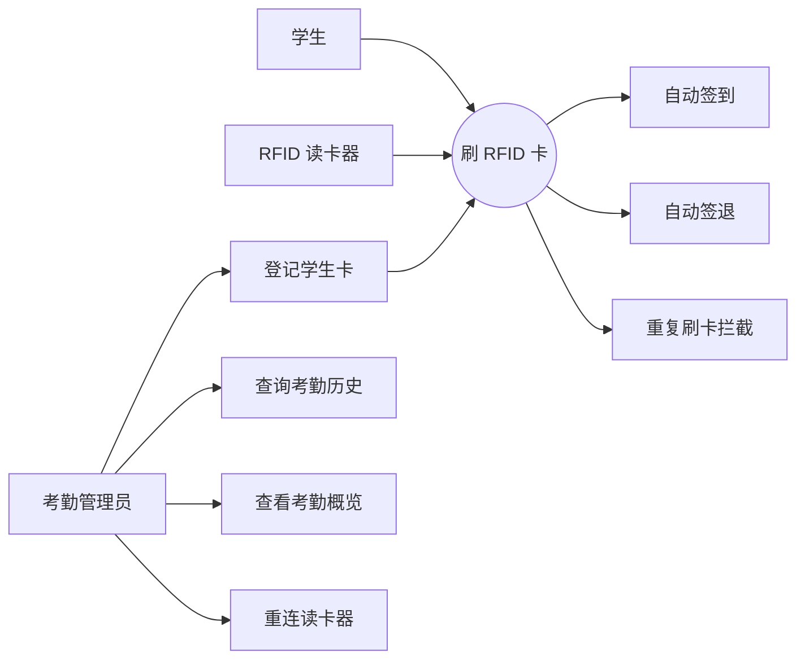
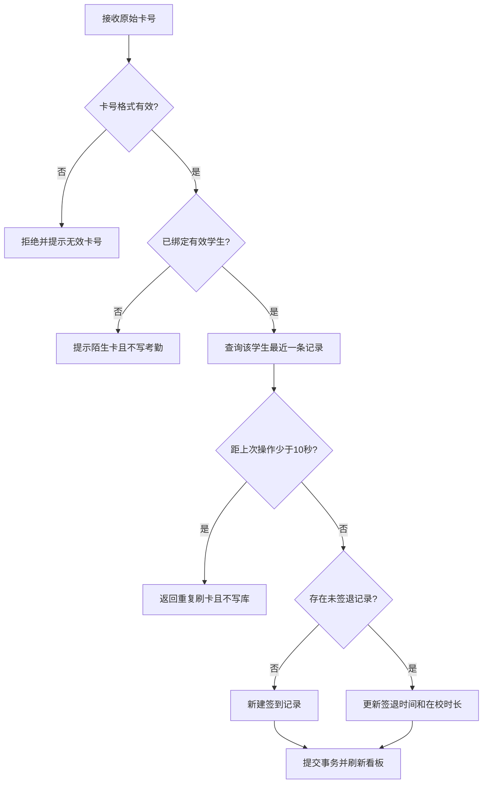
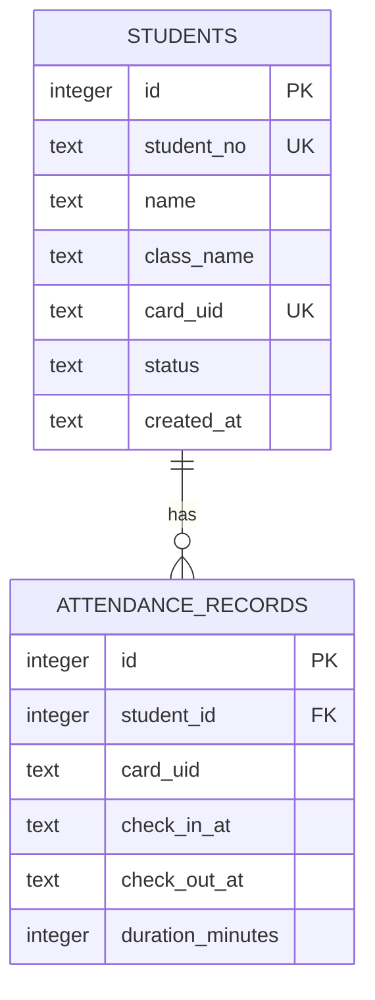

# RFID 一卡通考勤系统需求规格与建模

## 1. 项目范围

系统面向学校教室或实验室的单机考勤场景，使用 KL9007U UHF RFID 读卡器识别学生卡 EPC。系统完成学生卡登记、自动签到/签退、重复刷卡拦截、当前在校统计和历史记录查询。标签只作为身份标识，学生资料和考勤记录均保存在本机 SQLite 数据库。

不在当前范围内：联网多终端同步、人脸识别、请假审批、课程表联动、云端账号体系和向 RFID 标签写入个人资料。

## 2. 参与者

- 学生：使用已登记 RFID 卡完成签到或签退。
- 考勤管理员：登记陌生卡、查询记录、处理读卡器异常。
- RFID 读卡器：通过 USB 虚拟串口提供 EPC 卡号。

## 3. 功能需求

| 编号 | 需求 | 验收条件 |
| --- | --- | --- |
| FR-01 | 读取 RFID 卡号 | COM 连接成功后，页面能接收大写十六进制 EPC |
| FR-02 | 登记学生卡 | 陌生卡提示后可绑定唯一学号、姓名、班级和唯一卡号 |
| FR-03 | 自动签到 | 学生没有未签退记录时，刷卡新建签到记录 |
| FR-04 | 自动签退 | 学生存在未签退记录时，刷卡补充签退时间和在校分钟数 |
| FR-05 | 防重复录入 | 同一学生距离上次有效操作不足 10 秒时不修改数据库 |
| FR-06 | 陌生卡处理 | 返回明确提示，不产生考勤记录且程序不崩溃 |
| FR-07 | 脏卡号过滤 | 非十六进制、奇数长度、少于 8 位或超过 64 位的卡号被拒绝 |
| FR-08 | 断线容错 | 桥接进程退出后服务不中断，并在 3 秒后尝试重新连接 |
| FR-09 | 历史查询 | 可按姓名、学号、班级、卡号和日期查询考勤记录 |
| FR-10 | 实时概览 | 展示登记学生、今日签到、当前在校、今日签退和未签退名单 |
| FR-11 | 手工与模拟输入 | 可手工输入十六进制卡号，并提供受控的演示卡事件 |

## 4. 非功能需求

| 类型 | 要求 |
| --- | --- |
| 可用性 | 中文界面；签到、签退、重复、陌生卡使用不同状态文案和颜色 |
| 性能 | 读卡桥接约每 180 ms 盘存；前端约每 650 ms 拉取事件 |
| 可靠性 | SQLite 事务保证一次刷卡只完成一次状态变化；单个学生最多一条未签退记录 |
| 安全性 | 服务仅监听 `127.0.0.1`；卡号和输入均校验；SQL 使用参数绑定 |
| 可维护性 | 卡号校验、考勤判定、硬件通信分模块；关键纯逻辑有自动测试 |
| 数据一致性 | 时间使用 ISO 8601 入库，查询时按本地时区统计日期 |
| 兼容性 | Windows、Node.js 22.5+、.NET Framework 4、32 位厂商 DLL |

## 5. 用例图

## 6. 刷卡活动图

## 7. 数据模型

### 主键与约束说明

- `students.id`：内部自增主键，不使用姓名或学号作为关联键，避免资料修改影响历史记录。
- `students.student_no`：唯一业务键，防止同一学号重复登记。
- `students.card_uid`：唯一约束，防止一卡绑定多人。
- `attendance_records.id`：考勤记录主键。
- `attendance_records.student_id`：外键关联学生。
- 部分唯一索引 `idx_one_open_attendance_per_student`：只对 `check_out_at IS NULL` 的记录生效，数据库层保证一个学生最多存在一条未签退记录。

## 8. 核心业务规则

1. 最近没有记录，或最近记录已经签退：本次为签到。
2. 最近记录尚未签退：本次为签退。
3. 距上次签到或签退不足 10 秒：本次为重复数据，不写数据库。
4. 陌生卡与停用卡不产生考勤记录。
5. 签退时长按分钟向上取整，少于 1 分钟记为 1 分钟。
